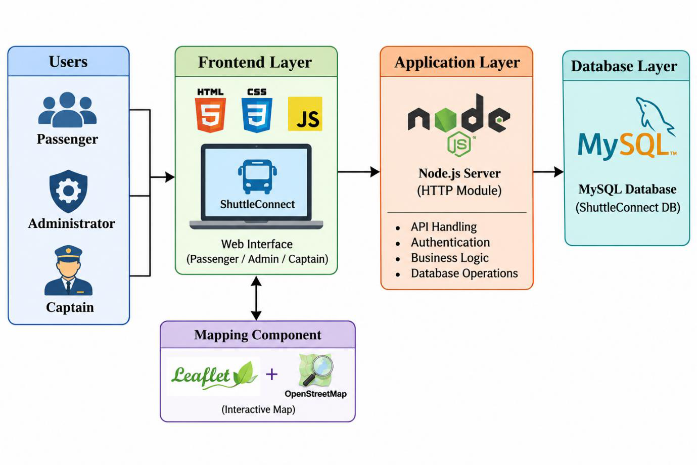
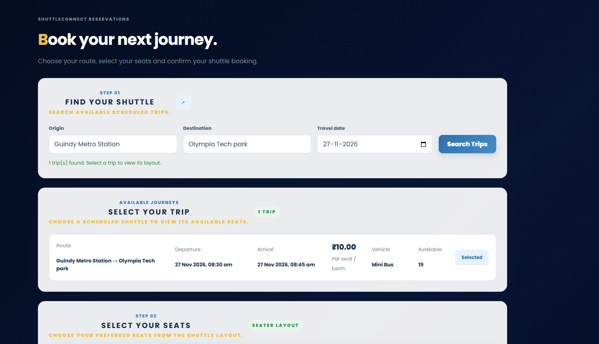
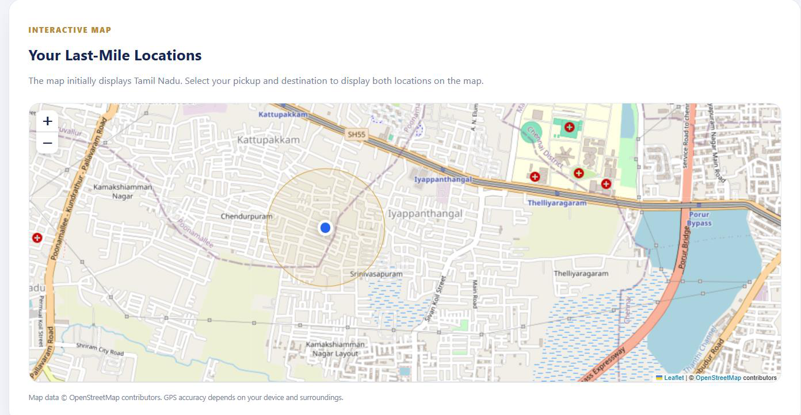
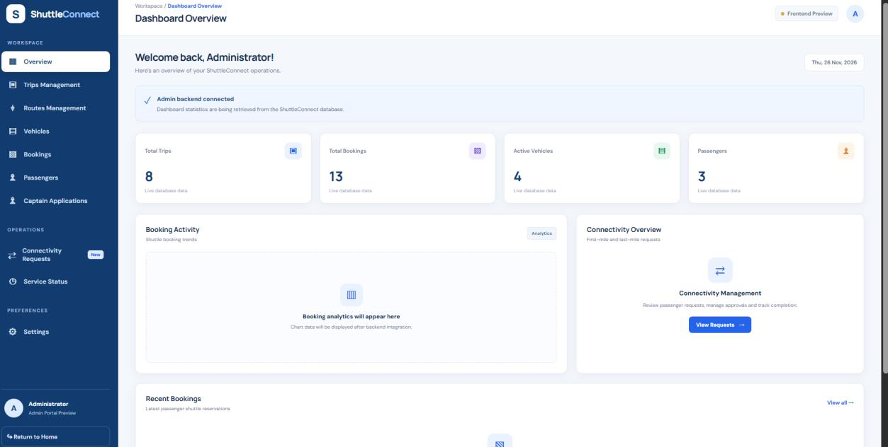
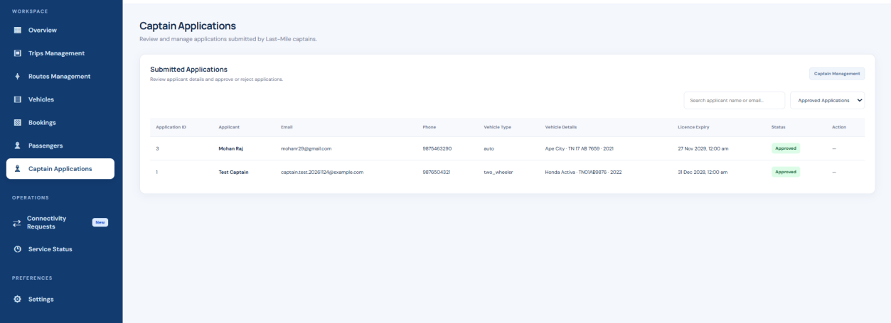

# Smart Shuttle Booking & Fleet Operations Portal

A centralized web application for scheduled shuttle reservations and fleet administration. The platform follows a **fixed origin-to-destination model**: passengers select predefined scheduled trips rather than creating custom routes.

## Overview

The Smart Shuttle Booking & Fleet Operations Portal brings passenger reservations, administrative operations and captain account workflows together in one application. It was developed as a full-stack project using a browser-based frontend, a Node.js backend and a MySQL relational database.

## Key Features

### Passenger
- Passenger registration and login.
- JWT-based authenticated access.
- Search and view predefined scheduled shuttle trips.
- Check seat availability and reserve seats.
- Generate booking references.
- View existing bookings and cancel eligible bookings.

### Administrator
- Manage shuttle routes, vehicles and scheduled trips.
- Update service status and monitor seat occupancy.
- Review captain applications and provision captain accounts.

### Captain onboarding
- Administrator-approved account provisioning.
- Time-limited activation-token workflow.
- Token validation and expiry checks.
- Password creation using bcryptjs hashing.
- One-time activation-token consumption.

### Booking integrity
- Validate trip and requested seat information before booking.
- Apply database-level safeguards against duplicate seat allocation.
- Test simultaneous booking requests competing for the last available seat.

### Interactive mapping
- Leaflet.js map interface using OpenStreetMap map data.
- Geographical visualization of shuttle-related locations.
- The report documents location selection and an interactive last-mile locations map.

> **Scope note:** The map feature documented here is interactive geographical visualization. Live GPS vehicle tracking is listed as future work. The report does not document a completed first-mile route-planning module, so this README does not claim one.

## Technology Stack

| Area | Technologies |
|---|---|
| Frontend | HTML, CSS, JavaScript |
| Backend | Node.js native HTTP module |
| API communication | REST-style HTTP endpoints |
| Database | MySQL |
| Local database environment | WAMP Server, phpMyAdmin |
| Authentication | JSON Web Tokens (JWT) |
| Password security | bcryptjs |
| Mapping | Leaflet.js, OpenStreetMap |
| PDF-related functionality | PDFKit |
| Development and testing | Visual Studio Code, Windows PowerShell |

## System Architecture

The application is organized into three main layers:

1. **Presentation layer:** HTML, CSS, JavaScript and role-based passenger, administrator and captain interfaces.
2. **Application layer:** Node.js native HTTP server, API handling, authentication, authorization and booking/fleet business logic.
3. **Data layer:** MySQL records for users, routes, vehicles, trips, bookings and captain profiles.



## Application Screenshots

### Passenger booking interface



### Interactive shuttle map



### Administrator dashboard



### Captain application management



## Security and Reliability

- JWT generation and verification for authenticated API access.
- bcryptjs password hashing.
- Role-Based Access Control (RBAC) for role-specific operations.
- Database-level booking safeguards to prevent duplicate allocation of the same seat during concurrent requests.
- Time-limited, validated and single-use captain activation tokens.

## Testing Documented

The internship report documents the following verification activities:

- Node.js and npm environment verification.
- WAMP and MySQL database inspection through phpMyAdmin.
- Passenger registration and login API testing.
- JWT token generation and protected-request verification.
- Booking API testing, including seat availability validation and booking-reference generation.
- Concurrent booking testing for requests competing for the last available seat.
- Captain activation and database-status verification.

## Local Development Setup

The project was developed and tested locally with Node.js and MySQL, using WAMP Server and phpMyAdmin for database administration.

### Prerequisites

- Node.js and npm
- MySQL
- WAMP Server / phpMyAdmin
- A code editor such as Visual Studio Code

### Run the backend

1. Clone or download this repository.
2. Open a terminal in the project directory.
3. Move into the backend folder:

   ```powershell
   cd backend
   ```

4. Install the backend dependencies:

   ```powershell
   npm install
   ```

5. Configure the local database connection using the environment variables expected by the backend. Keep credentials in a local `.env` file and do not commit secrets.
6. Ensure the MySQL service is running and the project database has been created and populated with the required schema.
7. Start the server:

   ```powershell
   node server.js
   ```

8. Open the frontend using a local development server and use the configured backend API address.

> The report describes a local WAMP/MySQL setup. Exact database names, environment-variable keys, SQL import filenames and frontend launch commands should be confirmed against the current repository files before publishing project-specific setup instructions.

## Future Enhancements

If the below technologies are extended further then it will be the Good to go product! 

- Payment gateway integration and refund processing.
- Live GPS-based shuttle tracking and estimated arrival times.
- Automated SMS, email or in-app passenger notifications.
- Implementing Agentic AI workflows to the admin panel replaces the manual work of admin to aprove the applications and perform CRUD!
- Fleet analytics and reporting dashboards.
- Dedicated Android and iOS applications.
- Expanded scheduled feeder-shuttle connectivity and external transportation-data integration.

## Project Context

**Project title:** Smart Shuttle Booking & Fleet Operations Portal  
**Domain:** Full-Stack Development


